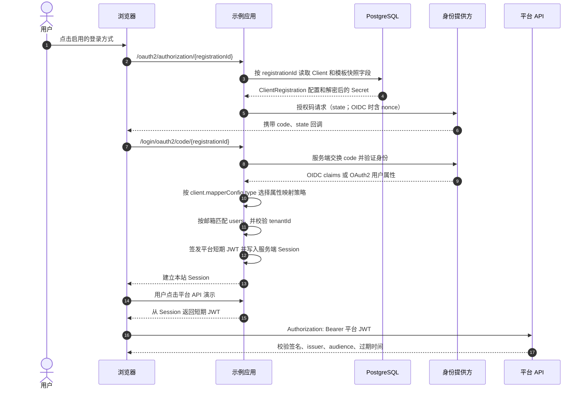

# Spring Security OAuth2 Client Lab

[](https://openjdk.org/projects/jdk/25/)
[](https://spring.io/projects/spring-boot)
[](https://spring.io/projects/spring-security)
[](https://www.postgresql.org/)
[](https://maven.apache.org/)
[](LICENSE)

简体中文 | [English](README.md)

面向学习 OAuth2 / OIDC 社交登录的 Spring Boot 示例。OAuth2 Client 与 provider 模板分别持久化；身份 mapper 的类型和类型专属配置嵌入 Client / 模板记录，不使用独立 mapper 表。模板只提供默认值，创建后的 Client 持有自己的运行配置。Spring Security 根据 PostgreSQL 中启用的 Client 动态创建 `ClientRegistration`。

## 技术栈

- Java 25、Spring Boot 4.1.2、Spring Security 7
- PostgreSQL、Flyway、MyBatis-Plus 3.5.17
- Spring MVC + Thymeleaf；浏览器使用 Session，平台 JWT 由服务端暂存（BFF）
- OAuth2 Authorization Code Flow；OIDC Client 和纯 OAuth2 Client 都可配置

## 本地启动

```bash
cp .env.sample .env
```

首次初始化数据库前，使用兼容 Spring Security 的 `PasswordEncoder` 生成管理员 BCrypt 密码哈希，并将其设置为 `.env` 中的 `OAUTH2_ADMIN_PASSWORD_HASH`。格式为 `{bcrypt}$2a$...`，不要在该文件中填写明文密码。Dex 是本地测试用身份提供方，client 和测试账号固定在 `dex/config.yaml` 中，无需环境变量。管理员入口默认显示在首页；Flyway 首次迁移会创建管理员账号并保存预先编码的密码哈希。本地 Dex 测试密码为 `dex-demo`，测试账号和 client 配置位于 `dex/config.yaml`；它们仅供本地学习，不要用于生产环境。Flyway 仅在管理员哈希非空时初始化管理员账号；Dex 测试 Client Secret 是随机生成的本地明文值，分别写入 Dex 配置和 Flyway seed，不依赖环境变量；该配置仅用于本地测试。OAuth2 Client Secret 和 Custom 映射密码在本示例中明文存储，仅适用于本地学习环境。`.env` 不应提交到版本库。

启动 PostgreSQL 并运行应用：

```bash
docker compose up -d postgres dex
./mvnw spring-boot:run
```

Flyway 的单个基线脚本会创建租户、凭据、Domain 与 Client 关联、OAuth2 Client 和模板，并预置四种 mapper 类型 `BASIC`、`CUSTOM`、`GITHUB`、`APPLE`。模板名称字段为 `name`。Dex 提供 `dex-local`、租户/客户映射、自定义租户名、禁止自动创建用户和新用户不激活等登录 Client，所有按钮只用于本地测试。Dex Client Secret 使用随机字符，以明文保存在 Flyway seed SQL 中，并与 `dex/config.yaml` 一致；仅供本地学习。管理页创建的其他 Client Secret 也以明文保存。管理页的 mapper 下拉框显示 `BASIC`、`CUSTOM`、`GITHUB` 三种通用选项；选择 Apple 模板时自动使用 `APPLE` mapper。打开 <http://localhost:8080/> 使用 `admin@local.invalid` 和管理员密码登录管理台。Dex 测试账号、两个 Domain、Client 分组和逐步映射结果见[Dex 用户与映射场景](docs/dex-test-scenarios.md)。

默认实例使用 8080。要测试第二个 Domain，在另一个终端运行 `SERVER_PORT=8081 SERVER_SERVLET_SESSION_COOKIE_NAME=JSESSIONID_8081 ./mvnw spring-boot:run`；两个实例共用 PostgreSQL 数据库。初始数据将租户/客户映射类 Client 关联到 `localhost:8081`，基础登录 Client 保留在 `localhost:8080`。

创建登录 Client 前，先从页面复制它生成的回调地址，并登记到对应的身份提供方应用。填写 OAuth Client ID 和 Secret，选模板及 mapper；Secret 明文保存，详情 API 中的 `clientSecret` 为空，编辑时留空会保留原值。Apple 的 Client Secret 应使用 Apple 签名的 client secret JWT。启用 Client 并关联到对应 Domain 后，该域名的首页会显示登录按钮。

```text
http://localhost:8080/login/oauth2/code/{registrationId}
```

模板预置 scopes：Basic OIDC `openid,profile,email`、Custom `openid,profile,email`、GitHub `read:user,user:email`、Apple `email,openid,name`。预置 Dex Client 使用 `openid,profile,email`。登录后按映射邮箱查找本地用户；普通租户 Client 只接受同租户用户，系统租户 Client 可匹配平台内已有用户。邮箱是本示例账号关联的关键字段，不使用 provider `iss + sub` 作为本地用户主键。BASIC 与 APPLE 使用标准 `email_verified` claim 判断邮箱验证状态；GitHub 通过其邮箱 API 选择已验证的主邮箱。

## ThingsBoard 对齐的数据模型

| 表 / 实体 | 职责 | 主要字段 |
|---|---|---|
| `tenant` / `TenantEntity` | Client 可关联的租户目录 | 字符串 ID、创建时间、name、email、additional_info、version |
| `domain` / `DomainEntity` | 租户下的登录域名配置 | 字符串 ID、租户 ID、域名、OAuth2 开关、创建时间 |
| `domain_oauth2_client` / `DomainOauth2ClientEntity` | 域名与 OAuth2 Client 的多对多关联 | 复合主键 `domain_id`、`oauth2_client_id` |
| `oauth2_client_template` / `OAuth2ClientTemplateEntity` | OAuth2 Client 配置模板和默认值 | name、协议/issuer、授权/token/user-info/JWK 地址、默认 scopes、用户名属性、认证方式、按钮字段、help link、mapper type 与按类型保存的 mapperConfig |
| `oauth2_client` / `OAuth2ClientEntity` | 可单独启用的运行时 Client；创建时从模板复制端点等配置 | registration ID、tenant ID、client ID、明文 secret、`loginButtonIcon`、`loginButtonLabel`、allow/activate user、端点、scopes、mapper type 与 Basic/Custom 配置、启用状态 |

这里将 mapper type 和各类型配置直接保存在模板与运行时 Client 中，并加入精简的租户目录及 domain 关联表。系统租户是特殊 Client 所属租户：只有归属系统租户的 Client 才会按映射结果确定新用户租户。BASIC/GITHUB/APPLE 支持 `EMAIL`（完整邮箱）、`DOMAIN`（邮箱 @ 后的域名）和 `CUSTOM`（从 provider claims 展开 `%{attribute}` 模板）；CUSTOM mapper 可直接返回 `tenantId` 或 `tenantName`。普通租户 Client 始终使用自己的租户，忽略 mapper 的租户字段。新建用户的客户归属可由 Custom mapper 的 `customerId` / `customerName` 或 Basic 的 `customerNamePattern` 指定；customerId 必须属于最终租户。`basic_default_dashboard_name` 和 `basic_always_full_screen` 不属于本例的 OAuth2 登录目标，因此未建模。平台租户角色和资源策略也未实现。

`oauth2_client_template.protocol` 描述协议，只允许 `OIDC` 或 `OAUTH2`；`mapperConfig.type` 描述身份 mapper 类型。四种类型 `BASIC`、`CUSTOM`、`GITHUB`、`APPLE` 使用不同配置形态：BASIC/GITHUB/APPLE 提供 `mapperConfig.basic`；CUSTOM 提供 `mapperConfig.custom`（URL、用户名、密码和是否发送 token）。前端提供三种可手动选择的 mapper：`BASIC`、`CUSTOM`、`GITHUB`。Apple 是预置模板专用类型，由模板自动带入，不出现在通用 mapper 选择器中。Dex Client 使用 `BASIC`，直接把自己的 OIDC 端点保存在运行时 Client 记录里，不新增模板类型。无关配置不会保存。

单个 Flyway 基线脚本预置系统租户（固定 ID `00000000-0000-0000-0000-000000000000`）供全局 Client 做 tenant mapping；该租户不能作为映射目标或 Domain 所属租户。租户名称唯一，用于按映射名称查找或创建租户。持久化 Mapper 使用 MyBatis-Plus `BaseMapper`，查询使用 Lambda Wrapper。重建后的基线脚本适用于空数据库；原来执行过多版本迁移的数据库保留旧 Flyway 历史，不要直接复用。需要迁移旧数据库时，应先备份数据并另行规划数据迁移。Client Secret 与 Custom 映射密码在本示例中明文存储，不会从查询 API 返回。

## 管理 API

除公开登录 Client 列表外，下列管理接口需要管理员 Session，并受 CSRF 保护：

| 方法 | 路径 | 说明 |
|---|---|---|
| `GET` | `/api/oauth2/config/template` | 查询模板及默认端点、scopes、mapper、按钮字段 |
| `POST` | `/api/oauth2/config/template` | 创建或更新 provider 模板；mapper 设置放在类型对应的 `mapperConfig` 中 |
| `DELETE` | `/api/oauth2/config/template/{clientRegistrationTemplateId}` | 删除未被 Client 引用的模板 |
| `GET` | `/api/tenants` | 查询租户目录 |
| `GET` | `/api/tenants/{id}` | 查询单个租户 |
| `POST` | `/api/tenants` | 创建租户；请求字段为 `name`、可选 `email` 和 `additionalInfo` |
| `GET` | `/api/users` | 查询最近创建的用户（最多 100 条） |
| `GET` | `/api/users/{id}` | 查询单个用户 |
| `POST` | `/api/domain?oauth2ClientIds={id1},{id2}` | 创建或更新域名并设置可用 OAuth2 Client |
| `PUT` | `/api/domain/{id}/oauth2Clients` | 替换指定域名关联的 OAuth2 Client ID 列表 |
| `GET` | `/api/domain/infos?pageSize=20&page=0` | 分页查询域名及其 Client 关联 |
| `GET` | `/api/domain/info/{id}` | 查询单个域名配置 |
| `DELETE` | `/api/domain/{id}` | 删除域名及其 Client 关联 |
| `GET` | `/api/oauth2/client/infos?pageSize=20&page=0` | 分页查询 Client，响应含 `data`、`totalPages`、`totalElements`、`hasNext` |
| `GET` | `/api/oauth2/client/infos?clientIds={id1},{id2}` | 按 ID 查询 Client 信息 |
| `GET` | `/api/oauth2/client/list?clientIds={id1},{id2}` | 按 ID 查询 Client 信息（ThingsBoard 对应接口） |
| `GET` | `/api/oauth2/client/{id}` | 查询单个 Client；`clientSecret` 字段为空，不回传凭据 |
| `POST` | `/api/oauth2/client` | 创建或按 `id` 更新 Client；Secret 留空时沿用已保存的 Secret |
| `DELETE` | `/api/oauth2/client/{id}` | 删除 Client |
| `GET` | `/api/oauth2/loginProcessingUrl` | 返回 OAuth2 登录回调处理路径 |
| `POST` | `/api/noauth/oauth2Clients` | 公开返回 ThingsBoard 兼容的 `name`、`icon`、`url` |
| `GET` | `/api/me` | 使用平台 JWT 获取当前账号信息 |

管理 API 使用单管理员 Session 和 CSRF 保护。ThingsBoard 的接口还按 `SYS_ADMIN` / `TENANT_ADMIN` 及 tenant 资源权限隔离；本示例通过单管理员保护管理域名。Domain 归属普通租户，关联的 Client 可属于同租户，也可属于系统租户。域名记录 host 或 host:port，不含 scheme/path；公开登录列表按请求 host 精确匹配已启用 Domain，仅返回已关联且启用的 Client。没有匹配的 Domain 时不显示登录方式。反向代理部署可通过 `X-Forwarded-Proto` / `X-Forwarded-Port` 传递外部 scheme/port。`tenant_profile` 暂未建模以保持租户表精简。不单独创建 mapper 持久化实体或 mapper REST 接口；Client 和模板 API 均使用嵌套 `mapperConfig`。

OAuth2 API 使用 ThingsBoard 同名路径和 HTTP 方法，包含 `/api/oauth2/config/template`、`/api/oauth2/client/*`、`/api/oauth2/loginProcessingUrl`、`/api/noauth/oauth2Clients` 及 Domain 的 OAuth2 关联接口；分页响应采用相同外壳，Client 与 Domain 的 `infos` 也提供同名查询参数。Client API 使用嵌套 `mapperConfig`（包含 `type`、`allowUserCreation`、`activateUser` 及 `basic` / `custom`）；示例额外保留 `tenantId`、模板关联和启用开关以支持独立运行。`platforms`、`pkgName` 已省略。`allowUserCreation` 控制 JIT 用户能否创建；`activateUser` 只控制新建用户的凭据是否启用，不会修改已有用户凭据。OAuth2 登录是否成功由外部认证和用户映射决定，不以本地密码凭据启用状态作为条件。用户持久化在 `users` 表中，按邮箱唯一匹配。普通租户 Client 限定本租户，系统租户 Client 允许匹配平台内已有用户，并对新用户执行 tenant mapping。用户 API 提供列表与详情读取，租户 API 提供列表、详情和创建。`basicCustomerNamePattern` 在映射出客户名时会查找或创建本地客户并关联新用户。mapper 类型与配置保存在 Client / 模板中，不单独维护 mapper 表；API 使用嵌套 `mapperConfig`。`templateId`、`protocol`、`issuerUri` 和 `enabled` 是本示例运行所需的扩展字段。`DomainOauth2ClientEntity` 映射域名与 Client 的复合主键关联；不建模 `propagateToEdge`，因为本示例没有 Edge 同步功能。为保持示例的单管理员授权模型，租户角色授权和移动端平台筛选不在范围内。登录 Client 列表仅返回请求 host 对应且已启用的 Domain 所关联的启用 Client。

用户实体使用 `UserEntity` 映射 `users` 表，保留租户、客户、用户名、邮箱、authority、姓名、additionalInfo、创建时间和版本字段；凭据启用状态及 BCrypt password hash 单独保存在 `user_credentials` 表并通过 `user_id` 关联。用户名与邮箱均可用于本地登录；普通 OAuth2 用户仍通过映射邮箱创建。示例没有实现注册、密码修改或 MFA。创建请求示例（租户 ID 默认值为迁移创建的默认租户）：

```json
{
  "id": "d49d6f3e-07a0-4fbe-97ea-616b155b62cc",
  "name": "公司 Google",
  "tenantId": "22222222-2222-4222-8222-222222222222",
  "templateId": "basic",
  "clientId": "provider-client-id",
  "clientSecret": "provider-client-secret",
  "scope": ["openid", "profile", "email"],
  "mapperConfig": {
    "type": "BASIC",
    "allowUserCreation": true,
    "activateUser": true,
    "basic": {
      "emailAttributeKey": "email",
      "firstNameAttributeKey": "given_name",
      "lastNameAttributeKey": "family_name",
      "tenantNameStrategy": "DOMAIN"
    }
  },
  "enabled": true
}
```

模板配置示例（CUSTOM 类型）：

```json
{
  "id": "custom",
  "name": "Custom OAuth2 / OIDC",
  "protocol": "OIDC",
  "issuerUri": "https://identity.example.com",
  "authorizationUri": "https://identity.example.com/oauth2/authorize",
  "accessTokenUri": "https://identity.example.com/oauth2/token",
  "userInfoUri": "https://identity.example.com/userinfo",
  "jwkSetUri": "https://identity.example.com/.well-known/jwks.json",
  "scope": ["openid", "profile", "email"],
  "mapperConfig": {
    "type": "CUSTOM",
    "allowUserCreation": true,
    "activateUser": true,
    "custom": {
      "url": "https://identity.example.com/oauth2/user",
      "sendToken": false
    }
  }
}
```

Custom mapper 使用配置的 HTTPS 用户属性端点；可选用户名和密码以明文入库，查询模板时不会返回密码。创建 Client 时会继承模板的 Basic 或 Custom 配置，Client 请求可以覆盖非密钥字段以及自带新的密码。

如果提供 `id`，必须是 UUID；该值同时作为 Spring Security 的 `registrationId`，因此需与已在身份提供方登记的回调 URI 一致。省略时由服务端生成 UUID。API 和管理页均不返回 Secret。

## 登录与平台 API 流程



## 代码入口

| 职责 | 代码 |
|---|---|
| 动态注册仓库 | `oauth2/DatabaseClientRegistrationRepository.java` |
| Client、模板、mapper 管理服务/API | `oauth2/OAuth2ClientService.java`、`web/OAuth2ClientController.java` |
| provider 用户属性映射 | `oauth2/ExternalUserResolver.java`、`oauth2/strategy/OAuth2ClientStrategyProvider.java`、`oauth2/strategy/*OAuth2ClientStrategy.java` |
| OAuth 成功后建立本地认证身份并签发访问令牌 | `security/SecurityUser.java`、`security/Oauth2AuthenticationSuccessHandler.java`、`token/JwtTokenFactory.java` |
| 管理员与 Session/API 安全链 | `security/SecurityConfiguration.java` |
| MyBatis-Plus mapper 和实体 | `persistence/mapper/`、`persistence/entity/` |
| 数据库结构和模板迁移 | `src/main/resources/db/migration/` |

## 示例边界

- OAuth2 Client、模板、mapper、本地管理员和 OAuth2 映射用户持久化在 PostgreSQL。示例按邮箱关联外部身份，没有单独保存 provider subject 映射表。
- 平台 JWT 的 HS256 密钥每次启动随机生成，重启会使旧令牌失效；真实系统应使用稳定的密钥管理和轮换方案。
- 首个管理员由 Flyway 迁移初始化，账号为 `admin`；迁移通过 `OAUTH2_ADMIN_PASSWORD_HASH` 接收预先编码的密码。空值会跳过管理员创建，已有账号不会被覆盖。此处不提供管理员账号生命周期或多管理员角色管理。
- 示例只监听本地 HTTP。部署前应配置 HTTPS、安全 Cookie、反向代理信任边界、密钥管理、登录审计、限流和账户生命周期。
- Google/GitHub 模板用于演示常见 OIDC / OAuth2 差异；未实现平台级多租户授权、客户持久化/分配、Apple 客户端密钥 JWT 或提供方会话注销。Custom mapper 采用本例定义的 HTTPS JSON 端点契约，尚未覆盖 ThingsBoard 的完整账户/客户生命周期。

## 验证

```bash
./mvnw spotless:check
./mvnw compiler:compile
```

## 许可证

本项目采用 Apache License 2.0。你可以按照根目录 [`LICENSE`](LICENSE) 中的条款使用、修改和分发本项目。再分发时，请附上许可证副本，并保留适用的版权与署名声明。该许可证包含明确的专利授权条款，且按“原样”提供，不提供任何担保。
